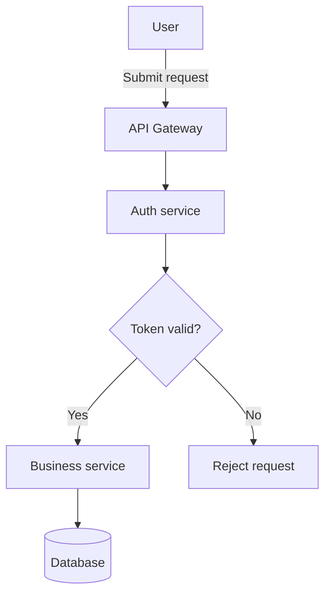
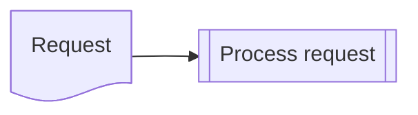

# Mermaid Diagram Generator

Turn requirements, code, or existing diagrams into readable Mermaid without inventing source details. Use the [diagram and shape catalog](./references/diagram-catalog.md) to choose a diagram family; consult official Mermaid syntax when support is uncertain.

## Workflow

1. **Identify the mode: create, repair, or explain.** For repair, inspect the original diagram and identify the error before changing it. For explain, describe the existing diagram's elements and relationships without inventing missing context.
2. **Select the diagram type and target compatibility.** Prefer a dedicated family over a generic flowchart when it better expresses the source. If the target renderer/version is unknown, use broadly supported syntax. Ask one focused question only when an ambiguity changes the meaning or a version-sensitive feature is required; otherwise state the assumption.
3. **Extract source-supported elements.** Identify participants, steps, decisions, transitions, entities, cardinalities, and any actual dates or quantities. Do not add unconfirmed behavior, dependencies, or metrics. Simplify dense inputs by splitting into focused diagrams when useful.
4. **Draft or minimally repair.** Keep stable ASCII node IDs distinct from display labels: for example, `ORDER_API["Order API"]`. For repairs, change only what causes the error or incompatibility, preserve the diagram's meaning, and explain the changes. If compatibility requires a semantic trade-off, explain it or offer an alternative rather than silently changing the diagram.
5. **Return the result.** For create/repair, provide a short scope explanation and a `mermaid` code fence. For explain, include a diagram only if requested. State material assumptions and the validation status: distinguish manual syntax review from actual parser or renderer checks. Never claim an unperformed check.

## Compatibility and accessibility

- Mermaid versions and host renderers differ (for example, GitHub, VS Code extensions, and Mermaid Live). Check official documentation and target support before selecting beta diagrams or version-sensitive syntax.
- New flowchart `@{ shape: ..., label: ... }` declarations require Mermaid 11.3.0+. Individual shape tokens may need a newer renderer; favor legacy delimiters for common shapes when the version is unknown.
- For flowcharts, use stable ASCII IDs and concise display labels. Spaces alone do **not** require quotes. Use `A["..."]` when a label contains syntax-sensitive punctuation, a reserved word such as `end`, or characters that conflict with Mermaid syntax. Use `<br/>` only when needed for readability.
- Where supported by the selected diagram family, supply a meaningful `accTitle` and `accDescr`. Also explain the diagram's essential meaning in surrounding prose, use descriptive relationship/branch labels, and do not rely on color alone to convey meaning.

## Examples

### Widely supported flowchart


### Additional shape syntax (Mermaid 11.3.0+)

Use [the shape catalog](./references/diagram-catalog.md#flowchart-shape-catalog) to check individual token support in the target renderer.



### Repair example

Cause: lowercase `end` is a reserved word in flowcharts, so using it as a node ID breaks parsing.

```text
Before: A --> end
After:  A --> END_STEP["end"]
```

Only the node ID changed; the displayed label and the relationship are preserved.

## Final checklist

- [ ] Mode and diagram family match the request; diagram header and syntax agree
- [ ] Source facts are preserved without invented entities, metrics, or relationships
- [ ] IDs, delimiters, arrows, branches, cardinalities, and labels are consistent
- [ ] Shape tokens and diagram family are supported by the target renderer, or compatibility is called out
- [ ] Labels, grouping, and optional accessibility text make the diagram understandable without relying on color
- [ ] Repair changes are minimal, meaning-preserving, and explained
- [ ] Any diagram is fenced as `mermaid`; assumptions and actual validation status are stated accurately
