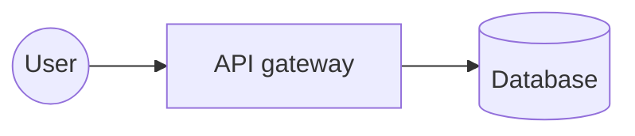

# Mermaid Diagram and Shape Catalog

Use this as a selection guide, not as a promise that every Mermaid renderer supports every feature. Mermaid's official documentation and implementation evolve; confirm the target renderer's Mermaid version for version-sensitive syntax.

## Diagram families

Choose a family based on the information being communicated. The official links below lead to Mermaid syntax documentation. An unverified minimum version is marked "Check target renderer"; it does not mean the diagram type is new. Beta syntax may change.

### Process, structure, and interaction

| Diagram | Choose it for | Official syntax | Min version / Status |
| --- | --- | --- | --- |
| Flowchart | Steps, branches, dependencies, and general system relationships | [Flowchart](https://mermaid.js.org/syntax/flowchart.html) | Check target renderer |
| Sequence diagram | Ordered messages between actors, components, or services | [Sequence](https://mermaid.js.org/syntax/sequenceDiagram.html) | Check target renderer |
| State diagram | States, transitions, and lifecycle behavior | [State](https://mermaid.js.org/syntax/stateDiagram.html) | Check target renderer |
| Class diagram | Classes, members, inheritance, and object relationships | [Class](https://mermaid.js.org/syntax/classDiagram.html) | Check target renderer |
| Entity relationship diagram | Entities, attributes, and data cardinalities | [ER](https://mermaid.js.org/syntax/entityRelationshipDiagram.html) | Check target renderer |
| Use case diagram | Actors and their goals/interactions with a system | [Use case](https://mermaid.js.org/syntax/usecase.html) | v12.0.0+ (beta) |
| C4 diagram | System context, containers, components, and deployments | [C4](https://mermaid.js.org/syntax/c4.html) | Check target renderer |
| Architecture diagram | Services, groups, and relationships in an architecture | [Architecture](https://mermaid.js.org/syntax/architecture.html) | Check target renderer |
| Block diagram | Blocks, ports, and directional connections | [Block](https://mermaid.js.org/syntax/block.html) | Check target renderer |
| Packet diagram | Bit fields and packet/header layouts | [Packet](https://mermaid.js.org/syntax/packet.html) | Check target renderer |
| Swimlanes | Activities organized across participants or responsibility lanes | [Swimlanes](https://mermaid.js.org/syntax/swimlanes.html) | Check target renderer |
| Event modeling | Events, commands, and read models in an event-driven domain | [Event modeling](https://mermaid.js.org/syntax/eventmodeling.html) | v11.15.0+ |
| Agent flow | Agent-oriented workflow and handoff representations | [Agent flow](https://mermaid.js.org/syntax/agentflow.html) | v12.0.0+ (beta) |

### Planning, chronology, and concepts

| Diagram | Choose it for | Official syntax | Min version / Status |
| --- | --- | --- | --- |
| Gantt | Tasks, durations, dependencies, and project schedules | [Gantt](https://mermaid.js.org/syntax/gantt.html) | Check target renderer |
| Kanban | Work items organized into columns and cards | [Kanban](https://mermaid.js.org/syntax/kanban.html) | Check target renderer |
| User journey | Stages and user experience across a journey | [User journey](https://mermaid.js.org/syntax/userJourney.html) | Check target renderer |
| Timeline | Events ordered chronologically | [Timeline](https://mermaid.js.org/syntax/timeline.html) | Check target renderer |
| Mindmap | Hierarchical ideas and associations | [Mindmap](https://mermaid.js.org/syntax/mindmap.html) | Check target renderer |
| Tree view | Hierarchical tree structures | [Tree view](https://mermaid.js.org/syntax/treeView.html) | v11.14.0+ (beta) |
| Git graph | Commits, branches, merges, and tags | [Git graph](https://mermaid.js.org/syntax/gitgraph.html) | Check target renderer |
| Requirement diagram | Requirements and their traceable relationships | [Requirements](https://mermaid.js.org/syntax/requirementDiagram.html) | Check target renderer |
| Wardley map | Value-chain components mapped by evolution and visibility | [Wardley](https://mermaid.js.org/syntax/wardley.html) | Check target renderer |
| Cynefin diagram | Domains and decision-making context | [Cynefin](https://mermaid.js.org/syntax/cynefin.html) | Check target renderer |
| Ishikawa diagram | Cause-and-effect analysis | [Ishikawa](https://mermaid.js.org/syntax/ishikawa.html) | Check target renderer |
| Railroad diagram | Grammar and syntax rules | [Railroad](https://mermaid.js.org/syntax/railroad.html) | Check target renderer |
| ZenUML | Sequence-style interactions using concise ZenUML syntax | [ZenUML](https://mermaid.js.org/syntax/zenuml.html) | Check target renderer |

### Charts and set relationships

| Diagram | Choose it for | Official syntax | Min version / Status |
| --- | --- | --- | --- |
| Pie chart | Parts of a whole | [Pie](https://mermaid.js.org/syntax/pie.html) | Check target renderer |
| Quadrant chart | Positioning items across two axes and four quadrants | [Quadrant](https://mermaid.js.org/syntax/quadrantChart.html) | Check target renderer |
| XY chart | Numeric series plotted against X/Y axes | [XY chart](https://mermaid.js.org/syntax/xyChart.html) | Check target renderer |
| Sankey diagram | Weighted flows between categories | [Sankey](https://mermaid.js.org/syntax/sankey.html) | Check target renderer |
| Radar chart | Comparing multiple dimensions across subjects | [Radar](https://mermaid.js.org/syntax/radar.html) | Check target renderer |
| Treemap | Hierarchical proportions and nested categories | [Treemap](https://mermaid.js.org/syntax/treemap.html) | Check target renderer |
| Venn diagram | Overlap and inclusion between sets | [Venn](https://mermaid.js.org/syntax/venn.html) | v11.12.3+ (beta) |

## Flowchart shape catalog

The generic node form `ID@{ shape: TOKEN, label: "Text" }` is available in Mermaid 11.3.0+. The [Mermaid 11.3.0 flowchart shape table](https://github.com/mermaid-js/mermaid/blob/mermaid%4011.3.0/packages/mermaid/src/docs/syntax/flowchart.md#complete-list-of-new-shapes) confirms the version for all tokens below except `datastore`, `folder`, `bucket`, `console`, `browser`, and `person`. Check those six tokens in the target renderer; their minimum version is not established here. The shape name alone does not guarantee that the renderer supports it.

| Meaning | Shape token | Typical use | Min version / Status |
| --- | --- | --- | --- |
| Process | `rect` | A normal action or processing step | v11.3.0+ |
| Event | `rounded` | An event or event-like step | v11.3.0+ |
| Terminal point | `stadium` | A start/end or terminal point | v11.3.0+ |
| Subprocess | `fr-rect` | A subprocess or separately defined activity | v11.3.0+ |
| Database | `cyl` | A database | v11.3.0+ |
| Data store | `datastore` | A data-flow store | Check target renderer |
| Folder | `folder` | A directory or folder | Check target renderer |
| Bucket | `bucket` | Object or cloud storage bucket | Check target renderer |
| Console | `console` | A command-line or terminal window | Check target renderer |
| Browser | `browser` | A browser or web client | Check target renderer |
| Person | `person` | A human actor | Check target renderer |
| Start | `circle` | A starting point | v11.3.0+ |
| Bang | `bang` | An emphasized or bang-shaped element | v11.3.0+ |
| Cloud | `cloud` | A cloud or cloud service | v11.3.0+ |
| Decision | `diam` | A decision or condition | v11.3.0+ |
| Prepare conditional | `hex` | Preparation or conditional step | v11.3.0+ |
| Data input/output | `lean-r` | Input/output or data operation | v11.3.0+ |
| Data input/output | `lean-l` | Reversed input/output or data operation | v11.3.0+ |
| Priority action | `trap-b` | A priority action | v11.3.0+ |
| Manual operation | `trap-t` | A manually performed operation | v11.3.0+ |
| Stop | `dbl-circ` | A stop point | v11.3.0+ |
| Text block | `text` | Text without a process-node shape | v11.3.0+ |
| Card | `notch-rect` | A card or notched process | v11.3.0+ |
| Lined/shaded process | `lin-rect` | A process needing a visual subcategory | v11.3.0+ |
| Start | `sm-circ` | A small start marker | v11.3.0+ |
| Stop | `fr-circ` | A framed stop marker | v11.3.0+ |
| Fork/join | `fork` | A fork or join in a process | v11.3.0+ |
| Collate | `hourglass` | Collation or collection | v11.3.0+ |
| Comment | `brace` | A comment/annotation brace | v11.3.0+ |
| Comment right | `brace-r` | A right-side comment/annotation brace | v11.3.0+ |
| Comment on both sides | `braces` | A two-sided comment/annotation brace | v11.3.0+ |
| Communication link | `bolt` | A communication link | v11.3.0+ |
| Document | `doc` | One document | v11.3.0+ |
| Delay | `delay` | A delay | v11.3.0+ |
| Direct access storage | `h-cyl` | Direct-access storage | v11.3.0+ |
| Disk storage | `lin-cyl` | Disk storage | v11.3.0+ |
| Display | `curv-trap` | A display | v11.3.0+ |
| Divided process | `div-rect` | A process divided into sections | v11.3.0+ |
| Extract | `tri` | An extraction step | v11.3.0+ |
| Internal storage | `win-pane` | Internal storage | v11.3.0+ |
| Junction | `f-circ` | A junction point | v11.3.0+ |
| Loop limit | `notch-pent` | A loop-limit step | v11.3.0+ |
| Manual file | `flip-tri` | A manual file operation | v11.3.0+ |
| Manual input | `sl-rect` | A manual input step | v11.3.0+ |
| Multiple documents | `docs` | A stack of documents | v11.3.0+ |
| Multiple processes | `st-rect` | A stack of processes | v11.3.0+ |
| Stored data | `bow-rect` | Stored data | v11.3.0+ |
| Summary | `cross-circ` | A summary | v11.3.0+ |
| Tagged document | `tag-doc` | A tagged document | v11.3.0+ |
| Tagged process | `tag-rect` | A tagged process | v11.3.0+ |
| Paper tape | `flag` | Paper-tape input/output | v11.3.0+ |
| Odd | `odd` | A special-purpose irregular shape | v11.3.0+ |
| Lined document | `lin-doc` | A lined document | v11.3.0+ |

Example:

Use only shapes that add information. For older renderers, prefer broadly supported delimiter syntax for common nodes, such as `A[Process]`, `B{Decision}`, `C[(Database)]`, and `D([Start/end])`. The generic shape syntax requires Mermaid 11.3.0+; for tokens marked "Check target renderer", confirm support separately before using them.

### Classic flowchart notation

These delimiter forms predate the generic shape syntax and remain useful for common shapes when targeting older Mermaid renderers:

| Shape | Notation | Example |
| --- | --- | --- |
| Rectangle | `ID[Label]` | `A[Process]` |
| Rounded rectangle | `ID(Label)` | `A(Submit request)` |
| Stadium | `ID([Label])` | `A([Start])` |
| Subroutine | `ID[[Label]]` | `A[[Call service]]` |
| Cylinder | `ID[(Label)]` | `A[(Database)]` |
| Circle | `ID((Label))` | `A((Start))` |
| Asymmetric | `ID>Label]` | `A>Input]` |
| Rhombus | `ID{Label}` | `A{Valid?}` |
| Hexagon | `ID{{Label}}` | `A{{Prepare}}` |
| Parallelogram | `ID[/Label/]` or `ID[\Label\]` | `A[/Input/]` |
| Trapezoid | `ID[/Label\]` or `ID[\Label/]` | `A[/Manual task\]` |
| Double circle | `ID(((Label)))` | `A(((Stop)))` |

The asymmetric form has only the documented orientation. Prefer the generic shape form when its broader shape vocabulary is needed and the renderer supports Mermaid 11.3.0+.
