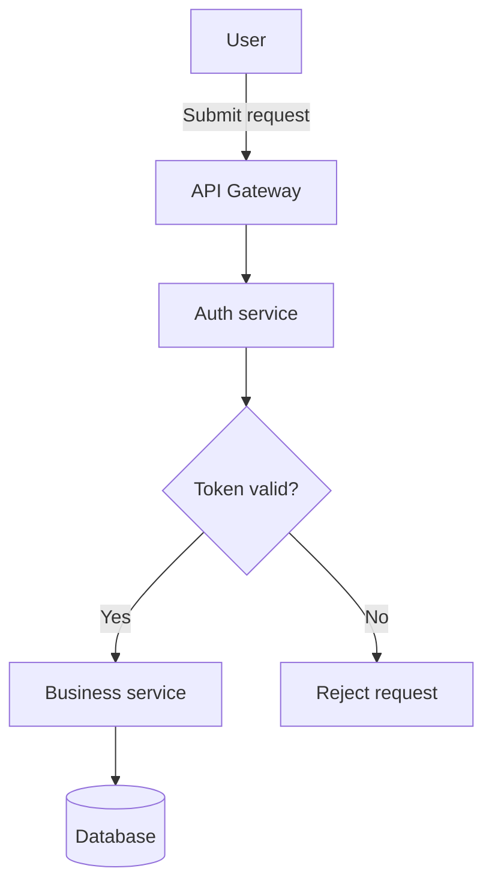

# Mermaid ダイアグラム生成

要件、コード、既存のダイアグラムを、ソースにない詳細を捏造せずに、読みやすい Mermaid に変換する。[ダイアグラムファミリーカタログ](./references/diagram-families.md)でダイアグラムファミリーを選択し、[フローチャートシェイプカタログ](./references/flowchart-shapes.md)でノードシェイプを確認する。サポート状況が不明な場合は Mermaid 公式構文を参照する。

## ワークフロー

1. **モードを特定する: 作成、修復、説明。** 修復の場合は、元のダイアグラムを調べ、変更する前にエラーを特定する。説明の場合は、既存ダイアグラムの要素と関係を、欠けているコンテキストを捏造せずに記述する。
2. **ダイアグラムタイプと対象の互換性を選択する。** ソースをより適切に表現できる場合は、汎用フローチャートよりも専用ファミリーを優先する。対象のレンダラー/バージョンが不明な場合は、広くサポートされている構文を使う。曖昧さが意味を変える場合やバージョン依存の機能が必要な場合のみ、焦点を絞った質問を 1 つ行う。それ以外の場合は前提を明示する。
3. **ソースに裏付けられた要素を抽出する。** 参加者、ステップ、分岐、遷移、エンティティ、カーディナリティ、実際の日付や数量を特定する。確認されていない振る舞い、依存関係、指標を追加しない。密度の高い入力は、有用な場合は焦点を絞った複数のダイアグラムに分割する。
4. **作成または最小限の修復を行う。** 安定した ASCII のノード ID を表示ラベルと区別する。例: `ORDER_API["Order API"]`。修復の場合は、エラーや非互換性の原因となっている部分のみを変更し、ダイアグラムの意味を保持し、変更内容を説明する。互換性のために意味上のトレードオフが必要な場合は、黙ってダイアグラムを変更せず、説明するか代替案を提示する。
5. **結果を返す。** 作成/修復の場合は、短いスコープ説明と `mermaid` コードフェンスを提供する。説明の場合は、要求された場合のみダイアグラムを含める。重要な前提と検証状況を明示する: 手動の構文レビューと、実際のパーサーやレンダラーによるチェックを区別する。実施していないチェックを実施したと主張してはならない。

## 互換性とアクセシビリティ

- Mermaid のバージョンやホストレンダラーは環境によって異なる(例: GitHub、VS Code 拡張機能、Mermaid Live)。ベータ版ダイアグラムやバージョン依存の構文を選択する前に、公式ドキュメントと対象環境のサポート状況を確認する。
- 新しいフローチャートの `@{ shape: ..., label: ... }` 宣言には Mermaid 11.3.0 以降が必要。個々のシェイプトークンにはさらに新しいレンダラーが必要な場合がある。バージョンが不明な場合は、一般的なシェイプには従来のデリミタを優先する。対象レンダラーでの個々のトークンのサポート状況は[シェイプカタログ](./references/flowchart-shapes.md)で確認する。
- フローチャートのエッジ `step` アニメーションと `flowchart.stepDuration`、`flowchart.stepNumbers` 設定には Mermaid 12.3.0 以降が必要。`step` には正の整数を指定し、同じ値のエッジは同時に再生される。印刷時や視差効果を減らす設定の利用者にも順序を示すには `flowchart.stepNumbers: true` を使う。視差効果を減らす設定ではアニメーションとハイライトが非表示になる。順序をアニメーションだけに頼って伝えない。[バージョン固定のフローチャート公式ドキュメント](https://github.com/mermaid-js/mermaid/blob/mermaid%4012.3.0/packages/mermaid/src/docs/syntax/flowchart.md#step-by-step-flow-animation-v1230)を参照する。
- フローチャートでは、安定した ASCII ID と簡潔な表示ラベルを使う。スペースだけでは引用符は**不要**。ラベルに構文に影響する句読点、`end` などの予約語、Mermaid 構文と競合する文字が含まれる場合は `A["..."]` を使う。`<br/>` は可読性のために必要な場合のみ使う。
- 選択したダイアグラムファミリーでサポートされている場合は、意味のある `accTitle` と `accDescr` を提供する。また、ダイアグラムの本質的な意味を周囲の文章でも説明し、説明的な関係/分岐ラベルを使い、色だけに頼って意味を伝えない。

## 例

### 広くサポートされているフローチャート



### 追加シェイプ構文(Mermaid 11.3.0 以降)

対象レンダラーでの個々のトークンのサポート状況は[シェイプカタログ](./references/flowchart-shapes.md)で確認する。


### 修復例

原因: 小文字の `end` はフローチャートの予約語であり、ノード ID として使うとパースが失敗する。

```text
Before: A --> end
After:  A --> END_STEP["end"]
```

変更したのはノード ID のみ。表示ラベルと関係は保持されている。

## 最終チェックリスト

- [ ] モードとダイアグラムファミリーがリクエストと一致し、ダイアグラムヘッダーと構文が一致している
- [ ] ソースの事実が保持され、捏造されたエンティティ、指標、関係がない
- [ ] ID、デリミタ、矢印、分岐、カーディナリティ、ラベルが一貫している
- [ ] シェイプトークンとダイアグラムファミリーが対象レンダラーでサポートされている、または互換性が明示されている
- [ ] ラベル、グループ化、オプションのアクセシビリティテキストにより、色に頼らずにダイアグラムを理解できる
- [ ] 修復の変更は最小限で、意味を保持し、説明されている
- [ ] すべてのダイアグラムが `mermaid` でフェンスされ、前提と実際の検証状況が正確に記述されている
