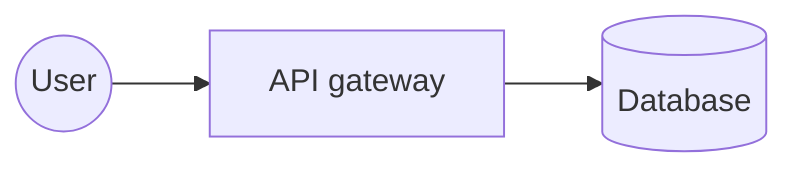

# Flowchart Shape Catalog

Shape tokens and classic delimiter notation for Mermaid flowcharts. For choosing a diagram family, see the [diagram families catalog](./diagram-families.md).

## Flowchart shape catalog

The generic node form `ID@{ shape: TOKEN, label: "Text" }` is available in Mermaid 11.3.0+. The [Mermaid 11.3.0 flowchart shape table](https://github.com/mermaid-js/mermaid/blob/mermaid%4011.3.0/packages/mermaid/src/docs/syntax/flowchart.md#complete-list-of-new-shapes) confirms the version for all tokens below except `datastore`, `folder`, `bucket`, `console`, `browser`, and `person`. These six tokens are verified in the official shape registry for [11.15.0](https://github.com/mermaid-js/mermaid/blob/mermaid%4011.15.0/packages/mermaid/src/rendering-util/rendering-elements/shapes.ts) and [11.17.0](https://github.com/mermaid-js/mermaid/blob/mermaid%4011.17.0/packages/mermaid/src/rendering-util/rendering-elements/shapes.ts), respectively; the listed versions are confirmed supported versions, not necessarily their first releases. The shape name alone does not guarantee that the host renderer supports it.

| Meaning | Shape token | Typical use | Min version / Status |
| --- | --- | --- | --- |
| Process | `rect` | A normal action or processing step | v11.3.0+ |
| Event | `rounded` | An event or event-like step | v11.3.0+ |
| Terminal point | `stadium` | A start/end or terminal point | v11.3.0+ |
| Subprocess | `fr-rect` | A subprocess or separately defined activity | v11.3.0+ |
| Database | `cyl` | A database | v11.3.0+ |
| Data store | `datastore` | A data-flow store | Confirmed in v11.15.0 |
| Folder | `folder` | A directory or folder | Confirmed in v11.17.0 |
| Bucket | `bucket` | Object or cloud storage bucket | Confirmed in v11.17.0 |
| Console | `console` | A command-line or terminal window | Confirmed in v11.17.0 |
| Browser | `browser` | A browser or web client | Confirmed in v11.17.0 |
| Person | `person` | A human actor | Confirmed in v11.17.0 |
| Start | `circle` | A starting point | v11.3.0+ |
| Bang | `bang` | An emphasized or bang-shaped element | v11.3.0+ |
| Cloud | `cloud` | A cloud or cloud service | v11.3.0+ |
| Decision | `diam` | A decision or condition | v11.3.0+ |
| Prepare conditional | `hex` | Preparation or conditional step | v11.3.0+ |
| Data input/output | `lean-r` | Input/output or data operation | v11.3.0+ |
| Data input/output | `lean-l` | Reversed input/output or data operation | v11.3.0+ |
| Priority action | `trap-b` | A priority action | v11.3.0+ |
| Manual operation | `trap-t` | A manually performed operation | v11.3.0+ |
| Stop | `dbl-circ` | A stop point | v11.3.0+ |
| Text block | `text` | Text without a process-node shape | v11.3.0+ |
| Card | `notch-rect` | A card or notched process | v11.3.0+ |
| Lined/shaded process | `lin-rect` | A process needing a visual subcategory | v11.3.0+ |
| Start | `sm-circ` | A small start marker | v11.3.0+ |
| Stop | `fr-circ` | A framed stop marker | v11.3.0+ |
| Fork/join | `fork` | A fork or join in a process | v11.3.0+ |
| Collate | `hourglass` | Collation or collection | v11.3.0+ |
| Comment | `brace` | A comment/annotation brace | v11.3.0+ |
| Comment right | `brace-r` | A right-side comment/annotation brace | v11.3.0+ |
| Comment on both sides | `braces` | A two-sided comment/annotation brace | v11.3.0+ |
| Communication link | `bolt` | A communication link | v11.3.0+ |
| Document | `doc` | One document | v11.3.0+ |
| Delay | `delay` | A delay | v11.3.0+ |
| Direct access storage | `h-cyl` | Direct-access storage | v11.3.0+ |
| Disk storage | `lin-cyl` | Disk storage | v11.3.0+ |
| Display | `curv-trap` | A display | v11.3.0+ |
| Divided process | `div-rect` | A process divided into sections | v11.3.0+ |
| Extract | `tri` | An extraction step | v11.3.0+ |
| Internal storage | `win-pane` | Internal storage | v11.3.0+ |
| Junction | `f-circ` | A junction point | v11.3.0+ |
| Loop limit | `notch-pent` | A loop-limit step | v11.3.0+ |
| Manual file | `flip-tri` | A manual file operation | v11.3.0+ |
| Manual input | `sl-rect` | A manual input step | v11.3.0+ |
| Multiple documents | `docs` | A stack of documents | v11.3.0+ |
| Multiple processes | `st-rect` | A stack of processes | v11.3.0+ |
| Stored data | `bow-rect` | Stored data | v11.3.0+ |
| Summary | `cross-circ` | A summary | v11.3.0+ |
| Tagged document | `tag-doc` | A tagged document | v11.3.0+ |
| Tagged process | `tag-rect` | A tagged process | v11.3.0+ |
| Paper tape | `flag` | Paper-tape input/output | v11.3.0+ |
| Odd | `odd` | A special-purpose irregular shape | v11.3.0+ |
| Lined document | `lin-doc` | A lined document | v11.3.0+ |

Example:

Use only shapes that add information. For older renderers, prefer broadly supported delimiter syntax for common nodes, such as `A[Process]`, `B{Decision}`, `C[(Database)]`, and `D([Start/end])`. Confirm each token's support in the target renderer.

Mermaid 12.3.0 added internal BPMN shape renderers and open-arrow and hollow-circle edge markers, but they are not documented as flowchart syntax in the [12.3.0 flowchart documentation](https://github.com/mermaid-js/mermaid/blob/mermaid%4012.3.0/packages/mermaid/src/docs/syntax/flowchart.md). Do not assume those internal names or markers work in flowcharts. See the [versioned changelog](https://github.com/mermaid-js/mermaid/blob/mermaid%4012.3.0/packages/mermaid/CHANGELOG.md) for the upstream changes.

### Classic flowchart notation

These delimiter forms predate the generic shape syntax and remain useful for common shapes when targeting older Mermaid renderers:

| Shape | Notation | Example |
| --- | --- | --- |
| Rectangle | `ID[Label]` | `A[Process]` |
| Rounded rectangle | `ID(Label)` | `A(Submit request)` |
| Stadium | `ID([Label])` | `A([Start])` |
| Subroutine | `ID[[Label]]` | `A[[Call service]]` |
| Cylinder | `ID[(Label)]` | `A[(Database)]` |
| Circle | `ID((Label))` | `A((Start))` |
| Asymmetric | `ID>Label]` | `A>Input]` |
| Rhombus | `ID{Label}` | `A{Valid?}` |
| Hexagon | `ID{{Label}}` | `A{{Prepare}}` |
| Parallelogram | `ID[/Label/]` or `ID[\Label\]` | `A[/Input/]` |
| Trapezoid | `ID[/Label\]` or `ID[\Label/]` | `A[/Manual task\]` |
| Double circle | `ID(((Label)))` | `A(((Stop)))` |

The asymmetric form has only the documented orientation. Prefer the generic shape form when its broader shape vocabulary is needed and the renderer supports Mermaid 11.3.0+.
